# Meraki MS220-24P en local, sans cloud

Firmware libre et interface d'administration web pour **Cisco Meraki MS220-24P**. Il permet de réutiliser un switch rattaché à un compte Meraki inaccessible ou dont la licence a expiré, au lieu de le jeter.

Le switch démarre sur un système Linux libre (noyau 3.18.131 + buildroot). Il pilote la puce de commutation avec **les modules Meraki présents dans sa propre mémoire NAND**, et se gère entièrement en local depuis un navigateur.

| Mode clair | Mode sombre |
|---|---|
| 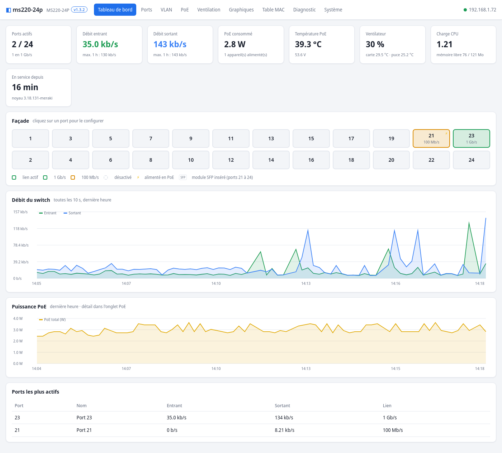 | 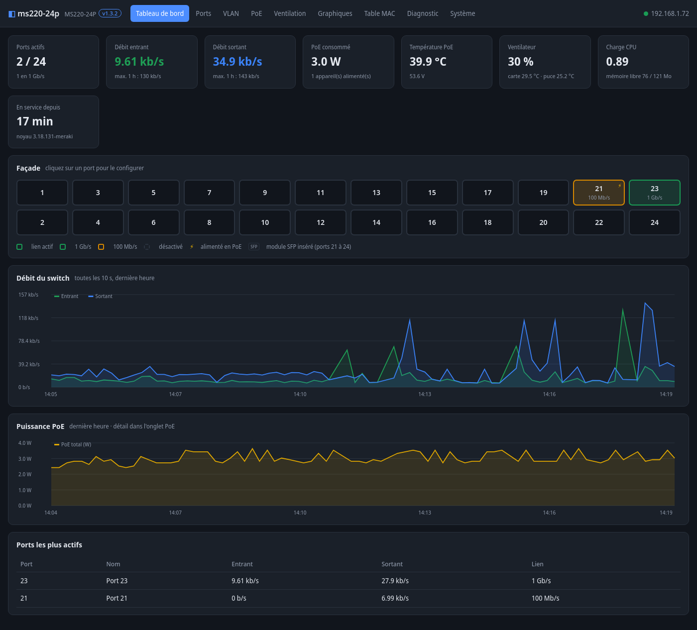 |

Ce projet s'appuie sur le travail de Hal Martin ([meraki-builder](https://github.com/halmartin/meraki-builder)). Il y ajoute :
- la compatibilité avec le **firmware Meraki 2023** (noyau 3.18.131) ;
- l'emplacement exact de la **console série du MS220-24P (J3)** ;
- une interface web complète et un système de mise à jour par paquet.

> **Avertissement.** Il faut dessouder la puce de la mémoire flash, la reprogrammer et la ressouder. Une erreur peut rendre le switch inutilisable. Faites **toujours** une sauvegarde de la puce d'origine avant toute écriture : elle permet de revenir exactement à l'état de départ.

---

## Sommaire

1. [Ce qui fonctionne](#1-ce-qui-fonctionne)
2. [Matériel nécessaire](#2-matériel-nécessaire)
3. [Vue d'ensemble](#3-vue-densemble)
4. [Sauvegarder la puce d'origine](#4-sauvegarder-la-puce-dorigine)
5. [Console série (J3)](#5-console-série-j3)
6. [Construire l'image](#6-construire-limage)
7. [Écrire l'image et premier démarrage](#7-écrire-limage-et-premier-démarrage)
8. [Interface d'administration](#8-interface-dadministration)
9. [Mises à jour](#9-mises-à-jour)
10. [Bouton reset](#10-bouton-reset)
11. [Ventilation](#11-ventilation)
12. [Accès SSH](#12-accès-ssh)
13. [Revenir au firmware Meraki](#13-revenir-au-firmware-meraki)
14. [Dépannage](#14-dépannage)
15. [Fonctionnement technique](#15-fonctionnement-technique)
16. [Contenu du dépôt](#16-contenu-du-dépôt)
17. [Crédits et licences](#17-crédits-et-licences)

---

## 1. Ce qui fonctionne

| Fonction | Détail |
|---|---|
| Commutation des 24 ports | 10/100/1000 Mb/s, pilote Vitesse de Meraki |
| Ports 21 à 24 | ports **combo** RJ45 / SFP 1 Gb/s : un seul des deux à la fois, le cuivre est prioritaire. Un module SFP inséré est détecté et affiché (fabricant, référence) |
| PoE / PoE+ | 802.3af/at sur les 24 ports, coupure et redémarrage par port, mesure de la puissance |
| VLAN | ports d'accès et trunks (VLAN autorisés, VLAN natif), VLAN d'administration |
| Ports | activation, vitesse et duplex forcés, isolation, protection contre les tempêtes de broadcast |
| Spanning Tree | RSTP, priorité du pont, port terminal (edge) automatique ou forcé |
| LLDP, IGMP snooping | activables |
| Miroir de port | entrant et/ou sortant, vers un port d'analyse |
| Test de câble | VeriPHY : état et longueur des 4 paires |
| Supervision | débit par port, PoE, températures, ventilateur, historique sur 1 h et 24 h |
| Appareils connectés | pour chaque port : adresse IP, nom (mDNS) et adresse MAC des appareils, relevés passivement par le moteur Meraki |
| Ventilation | automatique selon la température, avec préréglages |
| Administration | DHCP ou adresse fixe, nom, mot de passe, sauvegarde et restauration de la configuration |
| Mises à jour | paquets `.msu` envoyés depuis l'interface (interface et/ou noyau) |
| Bouton reset | 10 s : retour à la configuration par défaut |
| Heure | synchronisation NTP (passerelle puis pool.ntp.org) |

**Les ports SFP ne sont pas en 10 Gb/s.** Sur le MS220-24P, les 4 cages SFP sont des ports 1 Gb/s partagés avec les prises RJ45 21 à 24 (voir la [documentation Meraki](https://documentation.meraki.com/Switching/MS_-_Switches/Operate_and_Maintain/How-Tos/MS_Switch_SFP_and_SFP__Overview)). La puce VSC7427 ne gère pas le 10 Gb/s.

**Modèle testé :** MS220-24P avec le firmware Meraki du **18 mars 2023**, noyau `3.18.131-meraki`, dans la NAND. Pour un autre firmware, voir [Adapter à un autre firmware Meraki](#adapter-à-un-autre-firmware-meraki).

---

## 2. Matériel nécessaire

- **Programmateur de puces SPI** : XGecu **TL866II+** (testé), avec un **adaptateur SOP16** (ou SOP16 → DIP). Il est piloté sous Linux par [minipro](https://gitlab.com/DavidGriffith/minipro).
- **Station à air chaud** et fer à souder, flux, tresse à dessouder. La puce est un SOP16 au pas de 1,27 mm.
- **Adaptateur USB-série en 3,3 V** : CP2102, FTDI réglé en 3,3 V, etc. **Pas de 5 V.**
- **Deux résistances** : 1 kΩ et 1,3 kΩ (ou 1,2 kΩ). Elles abaissent le signal envoyé au switch vers 1,8 V.
- **Fils Dupont**, ou un petit connecteur 4 broches au pas de 2,54 mm à souder sur J3.
- **Un PC Linux** (Debian, Ubuntu…) avec environ 10 Go libres pour construire l'image.

---

## 3. Vue d'ensemble

```
1. Ouvrir le switch, dessouder la puce NOR (Macronix MX25L12845E, 16 Mo)
2. Lire la puce deux fois au programmateur, comparer, mettre la sauvegarde à l'abri
3. Construire l'image : ./build.sh  (ou utiliser l'image fournie)
4. Écrire l'image dans la puce, relire, comparer
5. Ressouder la puce, brancher la console série sur J3 (facultatif mais conseillé)
6. Allumer : environ 3 minutes plus tard, l'interface répond sur http://ADRESSE_DHCP/
```

La **NAND (128 Mo) n'est jamais modifiée**. Elle contient le firmware Meraki, d'où sont lus à chaque démarrage les modules du pilote de la puce de commutation et le modèle de configuration Click.

---

## 4. Sauvegarder la puce d'origine

### Repérer et dessouder la puce

La mémoire NOR est la puce **U6**, un **SOP16** marqué **MXIC MX25L12845E** (identifiant `0xC22018`). Elle se trouve près du ventilateur, au-dessus du connecteur **J18**. La **broche 1** est en haut à gauche, à côté du repère « 1 » sérigraphié. Notez son orientation avant de la dessouder, pour la remettre dans le même sens.

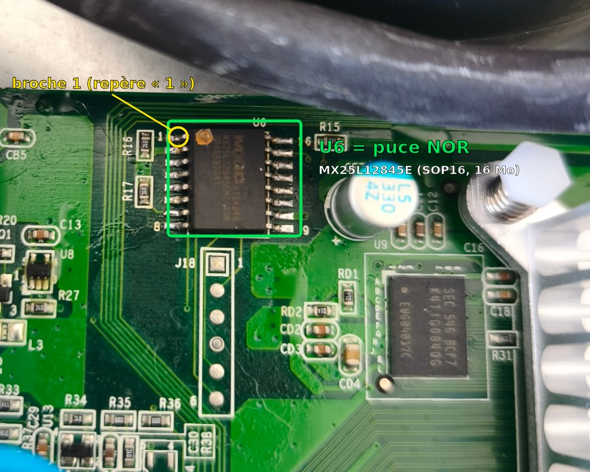

### Installer minipro

```sh
sudo apt install build-essential pkg-config libusb-1.0-0-dev git
git clone https://gitlab.com/DavidGriffith/minipro.git
cd minipro && make
sudo cp udev/60-minipro.rules /etc/udev/rules.d/ && sudo udevadm control --reload-rules
# débrancher et rebrancher le TL866
```

### Lire la puce deux fois

Placez la puce dans l'adaptateur SOP16, broche 1 du bon côté.

```sh
./minipro -p "MX25L12845E@SOP16" -D                          # doit afficher Chip ID: 0xC22018  OK
./minipro -p "MX25L12845E@SOP16" -r sauvegarde-1.bin
./minipro -p "MX25L12845E@SOP16" -r sauvegarde-2.bin
sha256sum sauvegarde-1.bin sauvegarde-2.bin                   # les deux empreintes doivent être identiques
```

Si l'identifiant lu est `0xFFFFFF` ou si les deux lectures diffèrent, la puce est mal en contact : remettez-la en place et recommencez. **Copiez la sauvegarde en lieu sûr**, sur un autre disque ou une clé USB. C'est votre seul moyen de revenir au firmware Meraki d'origine.

---

## 5. Console série (J3)

La console est **facultative** pour une installation qui se passe bien. Elle est **indispensable pour diagnostiquer** un problème : elle affiche tout le démarrage et donne un shell root.

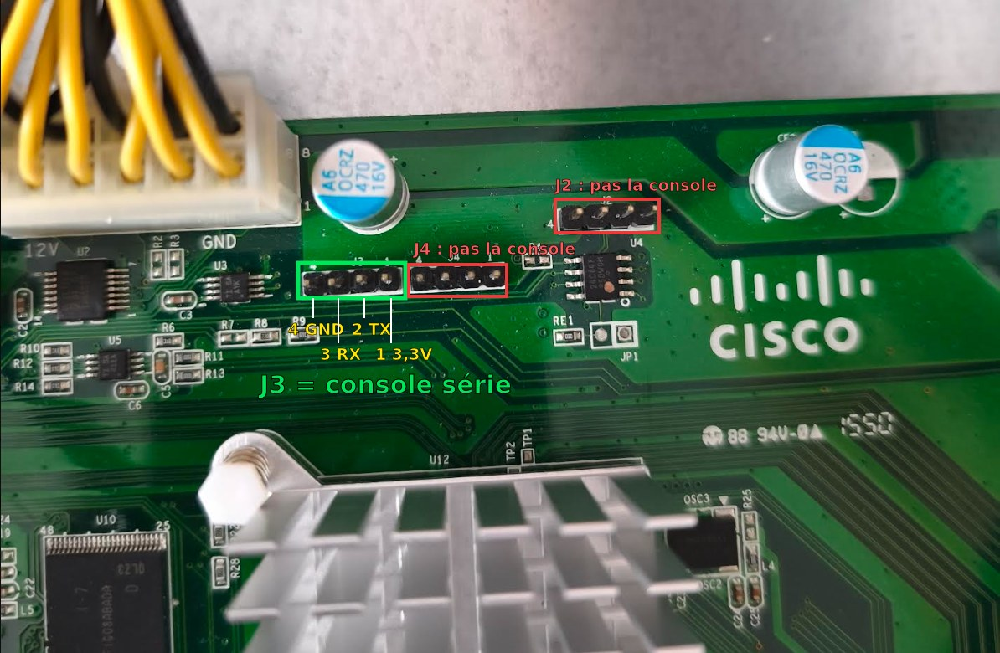

Le connecteur **J3** est situé près du connecteur d'alimentation 12 V, à gauche de J4. **J2 et J4 ne sont pas la console.**

| Broche J3 | Signal | Niveau | Branchement |
|---|---|---|---|
| 1 | 3,3 V | alimentation | **ne rien brancher** |
| 2 | TX du switch | 3,3 V au repos | → **RX** de l'adaptateur, en direct |
| 3 | RX du switch | **1,8 V** | ← **TX** de l'adaptateur **à travers le pont diviseur** |
| 4 | GND | masse | → **GND** de l'adaptateur |

L'entrée RX du switch (broche 3) fonctionne en **1,8 V**. Un TX à 3,3 V branché directement risque de l'abîmer. Il faut donc un pont diviseur :

```
  Adaptateur USB-série (3,3 V)                  Switch, connecteur J3
  ┌──────────┐                                  ┌──────────────────┐
  │      RX  ├──────────────────────────────────┤ 2  TX            │
  │          │                                  │                  │
  │      TX  ├────[ 1 kΩ ]────────┬─────────────┤ 3  RX (1,8 V)    │
  │          │                    │             │                  │
  │          │                [ 1,3 kΩ ]        │                  │
  │          │                    │             │                  │
  │     GND  ├────────────────────┴─────────────┤ 4  GND           │
  └──────────┘                                  │ 1  3,3 V : libre │
                                                └──────────────────┘
       3,3 V × 1,3 / (1 + 1,3) ≈ 1,87 V sur la broche 3
```

Réglages : **115200 bauds, 8 bits, sans parité, 1 bit d'arrêt (8N1), sans contrôle de flux**.

```sh
sudo apt install picocom
picocom -b 115200 /dev/ttyUSB0          # quitter : Ctrl+A puis Ctrl+X
```

Conseils :
- **Allumez d'abord le switch, puis branchez l'USB de l'adaptateur.** Sinon la mise sous tension peut faire déconnecter l'adaptateur USB, à cause de la différence de masse.
- Pour seulement **lire** le démarrage, les fils 2 (vers RX) et 4 (GND) suffisent.
- Avec le firmware Meraki d'origine, la console affiche le démarrage, puis une invite `<Meraki>` qui refuse toutes les commandes. C'est normal.
- Avec ce firmware, la console donne directement un **shell root** (`~ #`).

---

## 6. Construire l'image

### Option A : image fournie

Si une image précompilée est fournie avec une version publiée (*release*) du dépôt, vérifiez son empreinte SHA-256 avant de l'écrire.

### Option B : construire soi-même

Sur Debian ou Ubuntu :

```sh
sudo apt install build-essential git wget cpio unzip rsync bc file python3 xz-utils bzip2 \
                 libncurses-dev libssl-dev flex bison perl openssl
git clone https://github.com/JeremC82/Meraki-MS220-24P-Local.git
cd Meraki-MS220-24P-Local
./build.sh                    # 1 à 2 heures la première fois
```

Le script récupère et assemble :

| Élément | Source |
|---|---|
| buildroot 2023.02.4 | buildroot.org, configuration `firmware/rootfs/buildroot.config` |
| Scripts et paquets MS220 | [meraki-builder](https://github.com/halmartin/meraki-builder) (commit fixé) + `firmware/rootfs/overlay` |
| Noyau | sources GPL Meraki 3.18.123 ([switch-11-22-ms220](https://github.com/halmartin/switch-11-22-ms220)) + mises à jour Linux 3.18.124 à 3.18.131 (kernel.org) + `firmware/kernel/0001-skbuff-cb-96-octets.patch` + `firmware/kernel/config-3.18.131-meraki` |
| RedBoot | `redboot-nocrc-sz.bin` de [MS42-GPL-sources-3-18-122](https://github.com/halmartin/MS42-GPL-sources-3-18-122), empreinte vérifiée |
| `assoc_stub.ko` | `firmware/assoc_stub`, compilé avec le noyau |
| Serveur web | busybox 1.36.1 réduit à `httpd` (`firmware/httpd`) |
| Interface | `switchui/` |

Résultat :
- `build/switch-local.bin` : l'image de la puce complète (16 Mo) ;
- `build/kernel/kernel.part` : le noyau seul, pour un paquet de mise à jour.

Découpage de l'image :

| Adresse | Taille | Partition | Contenu |
|---|---|---|---|
| `0x000000` | 256 Ko | redboot | RedBoot sans contrôle de CRC ni de taille |
| `0x040000` | 2,75 Mo | kernel | en-tête `SPIM` (chargement et entrée à `0x81000000`) + noyau compressé |
| `0x300000` | 8 Mo | squashfs | système en lecture seule |
| `0xB00000` | 5 Mo | config | jffs2 : zone persistante superposée à `/etc` et `/root` |

---

## 7. Écrire l'image et premier démarrage

```sh
./minipro -p "MX25L12845E@SOP16" -D                         # Chip ID: 0xC22018  OK
./minipro -p "MX25L12845E@SOP16" -w build/switch-local.bin   # efface, écrit, vérifie (environ 3 min)
./minipro -p "MX25L12845E@SOP16" -r relecture.bin
sha256sum build/switch-local.bin relecture.bin              # empreintes identiques
```

Ressoudez la puce, **broche 1 du même côté qu'à l'origine**, et vérifiez au multimètre qu'il n'y a pas de pont entre broches. Branchez un port du switch sur votre réseau (avec un serveur DHCP), puis allumez.

**Premier démarrage, dans l'ordre (console série) :**
1. RedBoot, puis `Linux version 3.18.131-meraki` ;
2. lecture des modules dans la NAND : `Modules trouvés dans part1`, puis `Loaded 'luton26/vtss_core.ko …'` … `Loaded 'luton26/vc_click.ko'`. Le message `Request for unknown module key 'Cisco Meraki…'` est normal ;
3. `Using IP address: 192.168.x.y` (adresse obtenue en DHCP sur le VLAN 1) ;
4. `switchui: http://192.168.x.y/`.

Comptez **environ 3 minutes** entre la mise sous tension et la réponse de l'interface web. Sans console, cherchez l'adresse IP du switch dans la liste des baux DHCP de votre box ou routeur. Son adresse MAC commence par `e0:55:3d` ou `88:15:44`, préfixes Meraki.

**Identifiants par défaut de l'interface web :**
- identifiant : `admin` ;
- mot de passe : **le numéro de série du switch**, en majuscules, **sans tirets**, comme imprimé sur l'étiquette (par exemple `Q2XXABCD1234`).

Changez-le dans **Système → Accès à l'interface**.

---

## 8. Interface d'administration

Elle est accessible sur `http://ADRESSE_DU_SWITCH/` (port 80), avec authentification. Les requêtes venant d'un autre site sont refusées.

| Onglet | Contenu |
|---|---|
| **Tableau de bord** | façade des 24 ports, débits entrant et sortant, PoE, température, ventilateur, charge. **Cliquer sur un port** ouvre sa configuration, la liste des appareils connectés (IP, nom, MAC) et l'historique de son débit et de son PoE |
| **Ports** | tableau de tous les ports : état, lien, VLAN, PoE, STP, débit, compteurs, adresses MAC |
| **VLAN** | liste nommée des VLAN et tableau d'appartenance des ports (U non étiqueté / T étiqueté) |
| **PoE** | consommation, tension, température, coupure et redémarrage par port, graphique par appareil |
| **Ventilation** | vitesse, températures, courbe de ventilation, préréglages, historique |
| **Graphiques** | débit par port ou total, sur 1 h (pas de 10 s) ou 24 h (pas d'une minute) |
| **Table MAC** | adresses apprises avec l'IP et le nom de l'appareil, filtre, vidage |
| **Diagnostic** | test de câble, miroir de port, journal |
| **Système** | adresse IP (DHCP ou fixe), VLAN d'administration, nom, RSTP, LLDP, IGMP, mot de passe, mise à jour, sauvegarde et restauration, redémarrage |

Captures en mode clair (le mode sombre suit le réglage du système, voir `docs/captures/sombre/`) :

| Ports | Configuration d'un port |
|---|---|
| 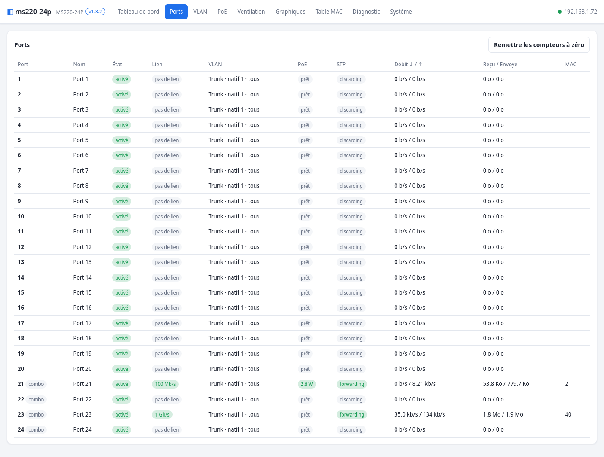 | 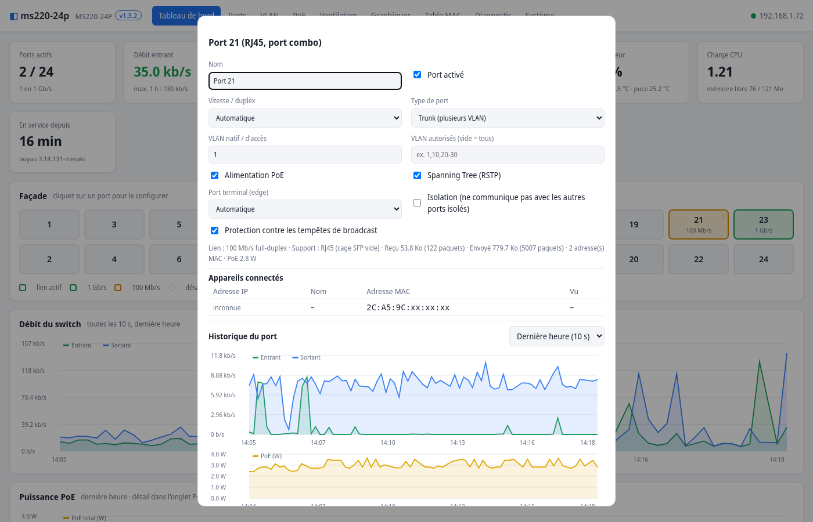 |
| **PoE** | **Ventilation** |
| 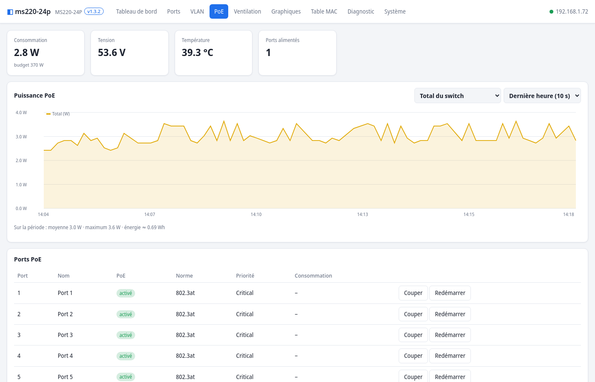 | 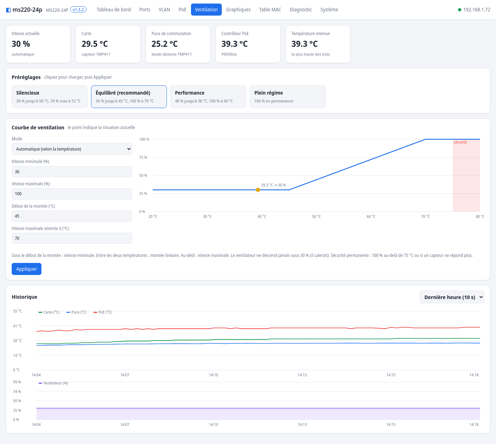 |
| **VLAN** | **Graphiques** |
| 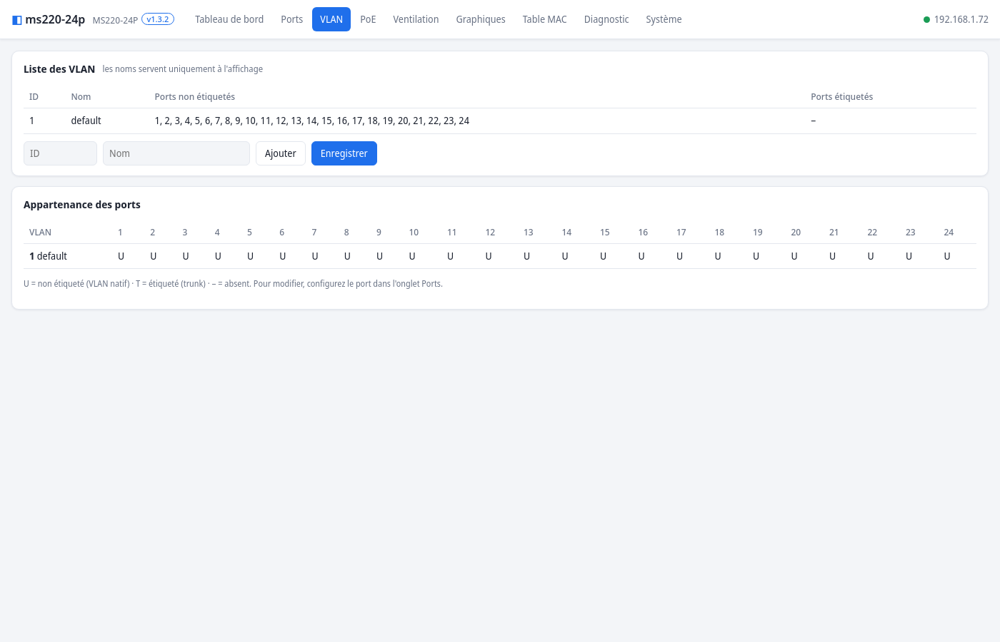 | 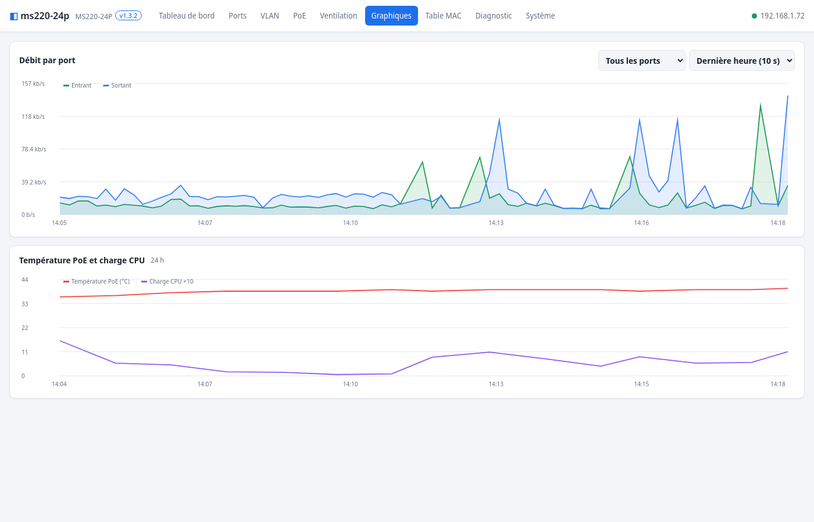 |
| **Diagnostic** | **Système** |
| 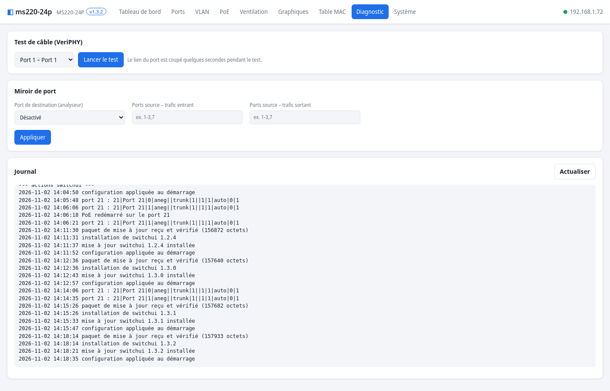 | 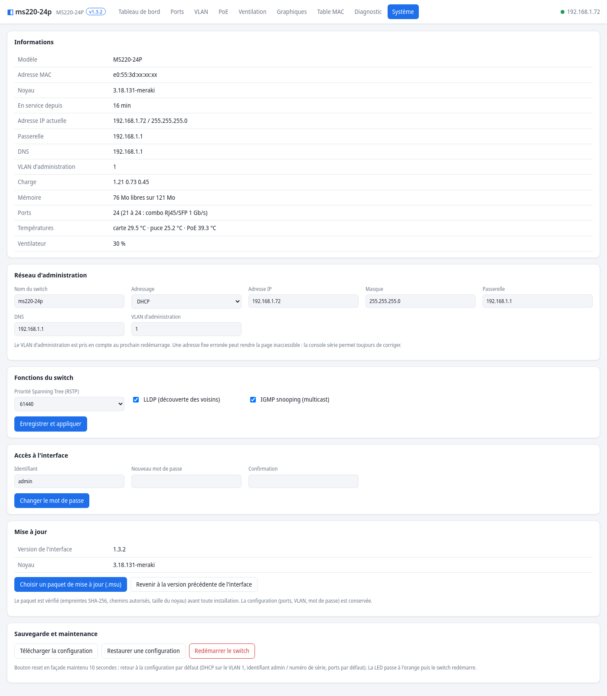 |

**La configuration est enregistrée** dans la zone persistante (`/etc/switchui/*.conf`) et réappliquée à chaque démarrage.
- **Changer le VLAN d'administration** prend effet au redémarrage suivant.
- **Une adresse IP fixe erronée** ou **un VLAN mal réglé sur le port d'accès** peuvent couper l'accès à l'interface. La console série ou le [bouton reset](#10-bouton-reset) permettent de récupérer.

---

## 9. Mises à jour

### Installer une mise à jour

**Système → Mise à jour → Choisir un paquet de mise à jour (.msu)**, puis **Installer**. L'interface affiche le contenu du paquet avant l'installation. Le paquet est **vérifié** avant tout changement :
- empreinte SHA-256 de chaque fichier ;
- chemins autorisés uniquement (`/etc`, noyau) ;
- taille et en-tête du noyau.

Un paquet corrompu ou non conforme est refusé.

- **Interface seule** : elle est préparée à côté (`/etc/switchui.new`), puis basculée d'un coup. Une coupure de courant laisse donc soit l'ancienne version complète, soit la nouvelle. La configuration (ports, VLAN, système, mot de passe) est conservée.
- **Noyau** : il est écrit dans la partition `kernel`, relu et vérifié, puis le switch redémarre (environ 3 minutes). **Ne coupez pas l'alimentation pendant cette étape.** Un noyau incomplet empêche le démarrage, et il faut alors réécrire la puce au programmateur.
- **Revenir à la version précédente** : un bouton dans la même carte restaure l'interface précédente, en gardant la configuration.

### Fabriquer un paquet de mise à jour

Après avoir modifié l'interface (`switchui/`), ou reconstruit le noyau :

```sh
# interface seule
echo 1.3.0 > switchui/VERSION
tools/make-update.sh -v 1.3.0 -d "Description de la mise à jour"

# interface + nouveau noyau (redémarrage automatique)
tools/make-update.sh -v 1.3.0 -d "Nouveau noyau" -k build/kernel/kernel.part

# noyau seul
tools/make-update.sh -v 1.3.0 -n noyau -d "Noyau seul" -k build/kernel/kernel.part --no-ui
```

| Option | Rôle |
|---|---|
| `-v VERSION` | **obligatoire**, affichée dans l'interface |
| `-n NOM` | nom du paquet (défaut `switchui`) |
| `-d TEXTE` | description affichée avant l'installation (sans `"`, `$`, `` ` ``, `\`) |
| `-k FICHIER` | noyau (`kernel.part`) à écrire dans la puce |
| `-s FICHIER` | script lancé sur le switch après la copie |
| `-e DOSSIER` | fichiers supplémentaires à installer dans `/etc` (arborescence relative à `/etc`) |
| `-r` | redémarrer après l'installation |
| `-o FICHIER` | nom du paquet produit (défaut `NOM-VERSION.msu`) |
| `--no-ui` | ne pas inclure l'interface |

Format d'un paquet `.msu` (archive tar compressée en gzip) :

```
manifest      NAME="…"  VERSION="…"  DESCRIPTION="…"  REBOOT="0|1"
sha256sums    empreinte de chaque fichier du paquet
etc/…         fichiers installés dans /etc (etc/switchui/… = interface)
kernel.part   (facultatif) image de la partition kernel, en-tête SPIM, 0x2C0000 octets maximum
install.sh    (facultatif) script exécuté après la copie
```

Pour développer, on peut aussi copier des fichiers par SSH (voir plus bas), puis redémarrer l'interface avec `/etc/init.d/S95switchui restart`.

---

## 10. Bouton reset

**Maintenez le bouton reset de la façade 10 secondes**, switch en marche. La LED d'alimentation passe à l'orange, puis le switch redémarre avec :
- l'adresse IP en **DHCP** sur le VLAN 1 ;
- l'identifiant web **admin / numéro de série** ;
- les ports, VLAN et réglages système **par défaut**.

Le firmware, les modules et l'interface restent installés : c'est un retour à la configuration par défaut **de ce firmware**, pas au firmware Meraki. Un appui court n'a aucun effet.

Le bouton est câblé sur la **GPIO 4** de la puce Vitesse (0 = enfoncé). Il est surveillé par `sbin/sui-button`, environ 3 minutes après la mise sous tension.

---

## 11. Ventilation

Le ventilateur est piloté en PWM (`/sys/class/hwmon/*/duty`, pilote `vcoreiiipwmfan`) selon **la plus haute** de ces températures :
- carte et puce de commutation (capteur **TMP411**) ;
- contrôleur PoE (**PD690xx**).

| Préréglage | Comportement |
|---|---|
| Silencieux | 30 % jusqu'à 50 °C, puis jusqu'à 70 % à 72 °C |
| **Équilibré** (par défaut) | 30 % jusqu'à 45 °C, puis jusqu'à 100 % à 70 °C |
| Performance | 40 % jusqu'à 38 °C, puis jusqu'à 100 % à 60 °C |
| Plein régime | 100 % en permanence |

La vitesse minimale est de **30 %** : en dessous, le ventilateur risque de caler. **Sécurité permanente** : 100 % au-delà de 75 °C, ou si aucun capteur ne répond. Une nouvelle consigne s'applique immédiatement.

---

## 12. Accès SSH

- Commande : `ssh root@ADRESSE_DU_SWITCH`.
- Mot de passe : **le numéro de série** (fixé au premier démarrage par `S14passwd` de meraki-builder).
- Pour une connexion par clé, ajoutez votre clé publique dans `/root/.ssh/authorized_keys`.
- `/etc` et `/root` sont persistants (jffs2). Le reste du système est en lecture seule.

Commandes utiles :

```sh
cat /click/sw0_ctrl/port_status                  # lien de chaque port
cat /click/switch_port_table/dump_pport_vlans    # VLAN par port
pd690xx -l                                       # PoE par port
cat /tmp/sui/actions.log                         # actions de l'interface
/etc/init.d/S95switchui restart                  # redémarrer l'interface
```

---

## 13. Revenir au firmware Meraki

Dessoudez la puce et réécrivez la sauvegarde d'origine :

```sh
./minipro -p "MX25L12845E@SOP16" -w sauvegarde-1.bin
./minipro -p "MX25L12845E@SOP16" -r relecture.bin && sha256sum sauvegarde-1.bin relecture.bin
```

Ressoudez la puce : le switch redémarre exactement comme avant, puisque la NAND n'a jamais été modifiée.

---

## 14. Dépannage

| Symptôme | Cause probable et solution |
|---|---|
| Rien sur la console | mauvaise broche : le TX du switch est J3 **broche 2**, la masse broche 4. Vérifiez 115200 8N1 |
| Caractères illisibles sur la console | masse mal reliée, ou adaptateur pas en 3,3 V |
| L'adaptateur USB se déconnecte à l'allumage | branchez l'USB **après** avoir allumé le switch |
| Le switch ne démarre plus du tout | puce mal ressoudée, ou image mal écrite : relire la puce et comparer l'empreinte |
| `part1 contient des modules pour 3.18.x, le noyau est 3.18.131` | le firmware Meraki de votre NAND n'est pas celui testé : voir ci-dessous |
| Démarrage figé pendant le chargement des modules | couper et remettre le courant : au démarrage suivant, le chargement est **sauté** automatiquement (fichier `/etc/kmods_pending`) et la console donne un shell. Relancer avec `/etc/init.d/S08kmods start` |
| Pas d'adresse IP | sans DHCP au bout de 60 s, le switch prend `169.254.0.10`. Brancher un port sur un réseau avec DHCP, ou régler une adresse fixe |
| Page web inaccessible après un changement d'adresse ou de VLAN | [bouton reset](#10-bouton-reset) 10 s, ou console série |
| Ports actifs mais aucun trafic | vérifier dans la console que les 6 modules sont chargés (`lsmod`) et que la ligne `Router could not be initialized` n'apparaît pas |

### Adapter à un autre firmware Meraki

Les modules Meraki ne se chargent que dans un noyau **construit exactement comme celui de Meraki**. Si votre NAND contient un autre firmware :
1. **Version** : la console affiche `part1 contient des modules pour 3.18.X`. Il faut un noyau `3.18.X-meraki` : adaptez la boucle des mises à jour dans `firmware/kernel/build-kernel.sh`. La chaîne `vermagic` des modules doit être identique (`strings vtss_core.ko | grep vermagic`).
2. **`struct module`** : comparez la taille de la section `.gnu.linkonce.this_module` et les décalages de `init_module` et `cleanup_module` (`readelf -SW`, `readelf -r`) entre un module Meraki et un module compilé avec votre noyau. Ici, `CONFIG_MODULE_SIG=y` ajoutait les 4 octets manquants.
3. **`struct sk_buff`** : comparez les décalages lus par `vc_click.ko` (désassemblage de `FromVitesse::alloc_pkt` et `xtr_cb`) avec `offsetof()` dans votre noyau. Ici, `cb[]` devait faire 96 octets.
4. **Symboles manquants** (`Unknown symbol` au chargement) : fournissez-les dans `firmware/assoc_stub`, comme `register_click_association_table_cbs`.

---

## 15. Fonctionnement technique

**Démarrage**
1. RedBoot (`redboot-nocrc-sz`) charge l'en-tête `SPIM` à `0x40000`, puis décompresse et lance le noyau à `0x81000000`.
2. Le noyau monte le squashfs (`root=/dev/mtdblock3`), puis la zone jffs2 en overlay sur `/etc` et `/root`.
3. `S08kmods` trouve l'archive gzip du firmware Meraki dans la partition UBI `part1` (puis `part2`) de la NAND, avec `find_hdr`. Il en extrait `lib/modules/*` et `etc/switch.template`, vérifie la version, puis charge `vtss_core` → `assoc_stub` → `proclikefs` → `merakiclick` → `elts_meraki` → `vc_click`.
4. `S09clickinit` charge dans le moteur Click (`/click/config`) le modèle de configuration **extrait du même firmware** que les modules.
5. `S10clickconfig` (meraki-builder) configure le switch « vierge » et obtient l'adresse en DHCP. `S11poe` initialise le contrôleur PoE.
6. `S95switchui` :
   - copie l'interface vers `/etc/switchui` au premier démarrage ;
   - règle le DNS et la synchronisation NTP ;
   - réapplique la configuration enregistrée ;
   - lance le collecteur d'historique, le régulateur du ventilateur, la surveillance du bouton reset et le serveur web.

**Pourquoi un noyau 3.18.131 modifié.** Meraki n'a publié que les sources du 3.18.123. Les modules du firmware 2023 exigent :

| Exigence | Solution |
|---|---|
| `vermagic = 3.18.131-meraki mod_unload MIPS32_R2 32BIT` | mises à jour officielles 3.18.124 à 3.18.131 + `CONFIG_LOCALVERSION="-meraki"` |
| `struct module` de 0x15c octets (`init` à 0xc4) | `CONFIG_MODULE_SIG=y` (non imposé : les modules signés par Meraki se chargent avec un simple avertissement) |
| `sk_buff.cb` de 96 octets (données à 0xe0) | correctif `0001-skbuff-cb-96-octets.patch` |
| `register_click_association_table_cbs` et `unregister_…` (noyau Meraki, code non publié) | module `assoc_stub` qui les fournit |

Les modules n'utilisent pas `MODVERSIONS`, donc seuls la version et la disposition des structures comptent.

**Interface.** C'est un serveur `busybox httpd` (authentification Basic, CGI) avec deux scripts shell :
- `cgi-bin/api` lit et écrit les « handlers » Click, par exemple :
  - `switch_port_table/set_port_phy_cfgs` (`PORT n, MODE aneg|off|forced, FORCE_SPEED 100fdx…`) ;
  - `set_vlan_allports_conf` (`PORT n, ALLOWED_VLANS "…", PVID…`) ;
  - `stp/set_many_port_cfgs`, `set_port_isolation`, `set_port_storm_control` ;
  - `sw0_ctrl/mirror_port` et `mirror_ports` (`INGRESS_PORTS 1-3, EGRESS_PORTS 5`), `veriphy_start`… ;
- `cgi-bin/update` gère les paquets `.msu`.

Les pages sont en HTML, CSS et JavaScript sans dépendance externe, et les graphiques sont dessinés en canvas.

---

## 16. Contenu du dépôt

```
build.sh                         construction complète de l'image
switchui/                        interface d'administration (installée dans /etc/switchui)
  www/                           pages, cgi-bin/api, cgi-bin/update
  lib/sui.sh                     configuration et application au switch
  sbin/sui-collect               historique (débits, PoE, températures)
  sbin/sui-fan                   régulation du ventilateur
  sbin/sui-button                bouton reset
  init/S95switchui               démarrage de l'interface
  bin/httpd                      serveur web (busybox, voir firmware/httpd)
tools/make-update.sh             fabrication des paquets .msu
firmware/
  kernel/                        script, configuration et correctif du noyau 3.18.131-meraki
  assoc_stub/                    module de compatibilité
  rootfs/                        configuration buildroot et scripts de démarrage modifiés
  httpd/                         construction du serveur web
  image/make-image.sh            assemblage de l'image 16 Mo
docs/                            photos et captures
```

---

## 17. Crédits et licences

- **Hal Martin** : [meraki-builder](https://github.com/halmartin/meraki-builder) (GPL v3), RedBoot modifié et miroirs des sources GPL Meraki ([switch-11-22-ms220](https://github.com/halmartin/switch-11-22-ms220), [MS42-GPL-sources-3-18-122](https://github.com/halmartin/MS42-GPL-sources-3-18-122)). Ce projet n'existerait pas sans ce travail.
- Noyau Linux, buildroot, busybox : GPL v2.
- Les scripts de démarrage dérivés de meraki-builder (`firmware/rootfs/overlay`) restent sous **GPL v3**. Le reste de ce dépôt est publié sous la même licence.
- **Aucun fichier Meraki n'est distribué ici.** Les modules propriétaires et le modèle de configuration sont lus, à chaque démarrage, dans le firmware Meraki déjà présent dans la NAND de votre propre switch.
- Cisco et Meraki sont des marques de Cisco Systems, Inc. Ce projet n'est ni affilié à Cisco, ni approuvé par Cisco.
