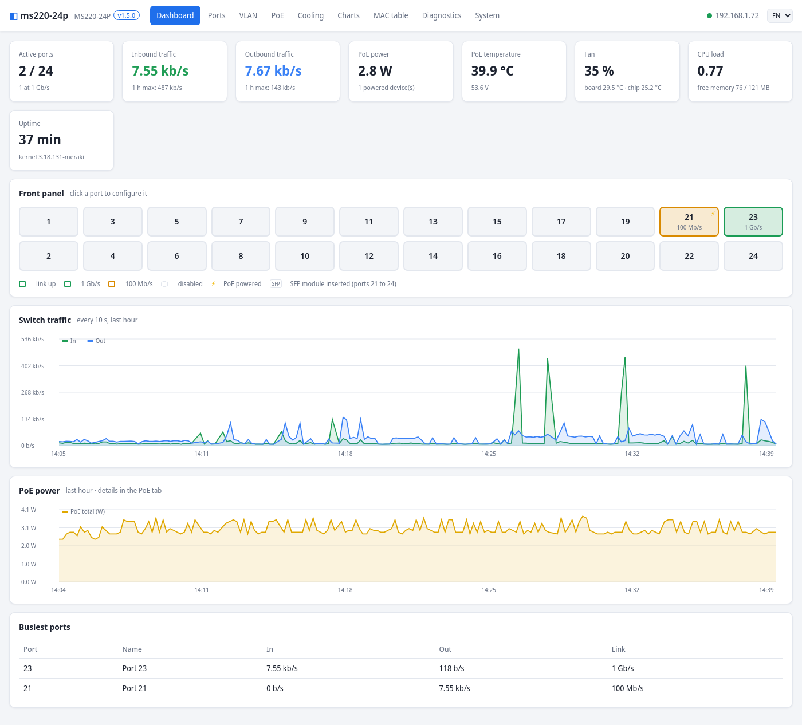
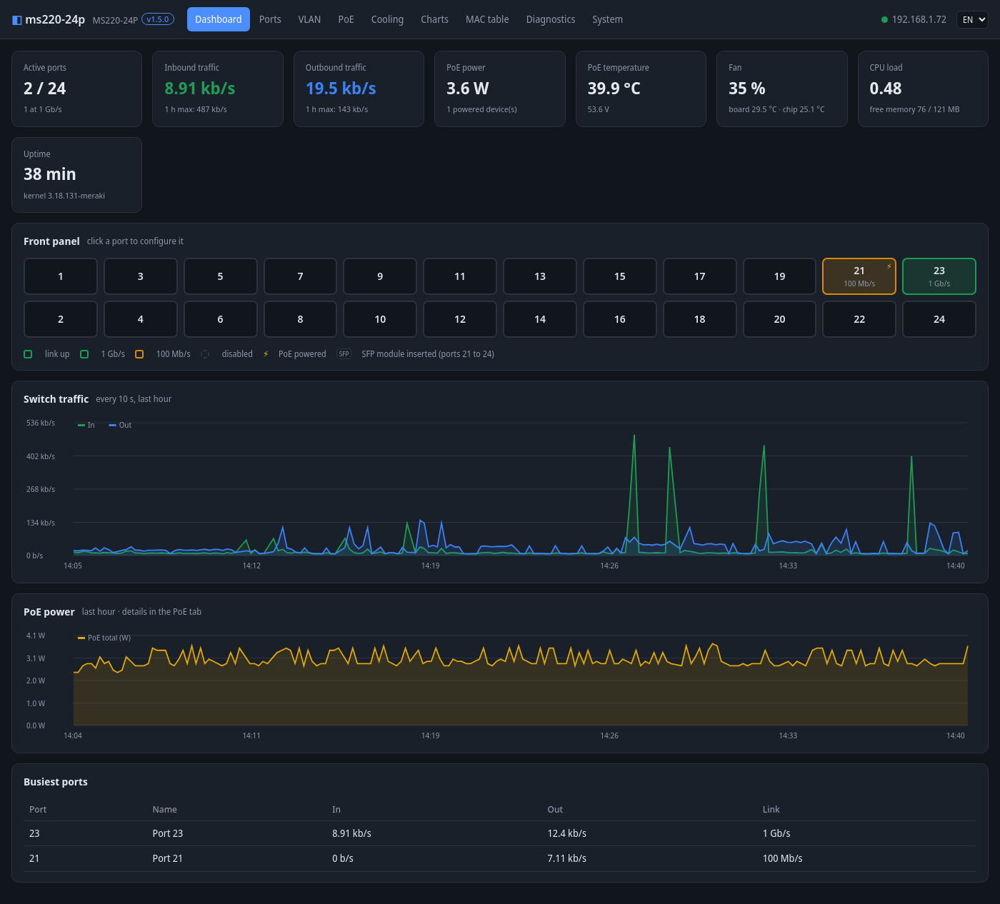
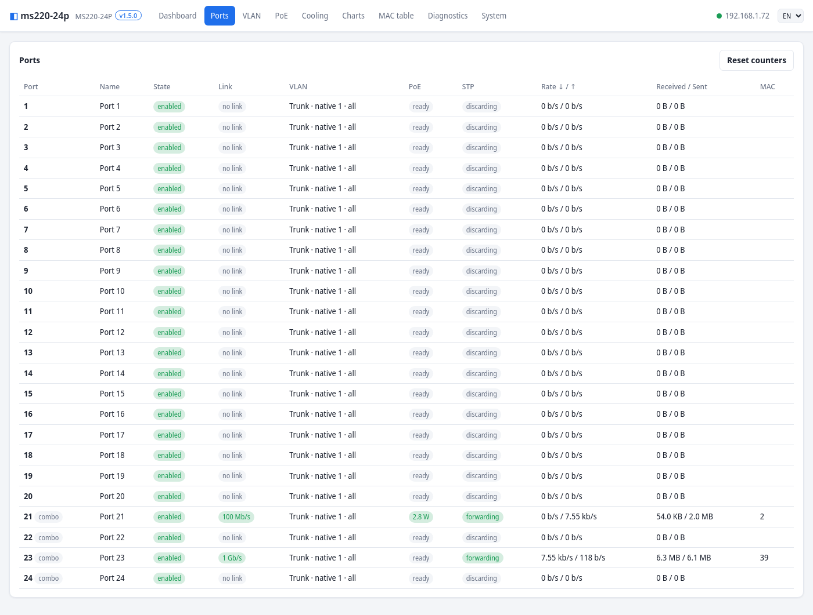
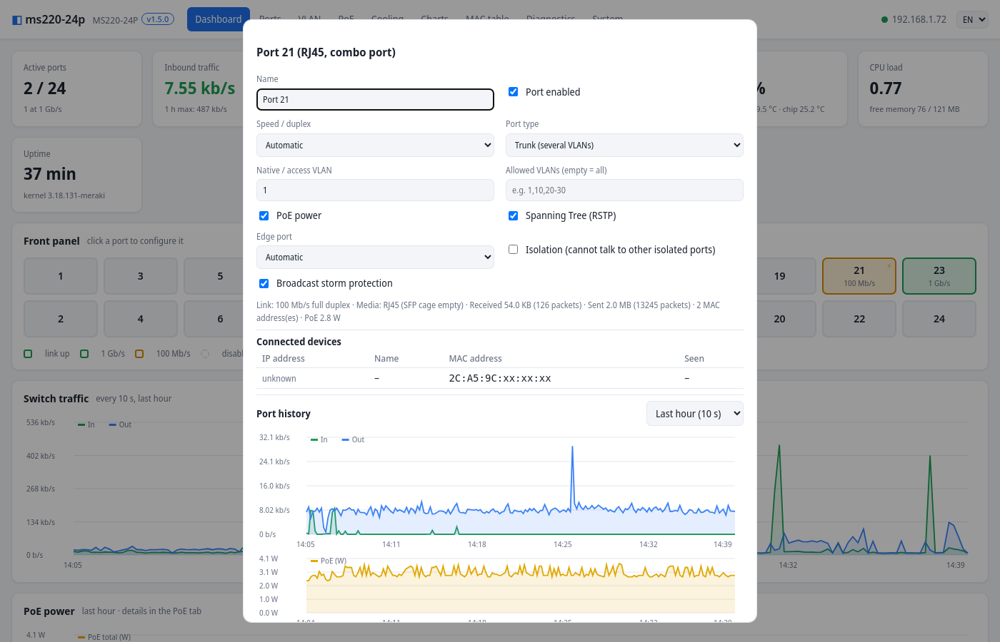
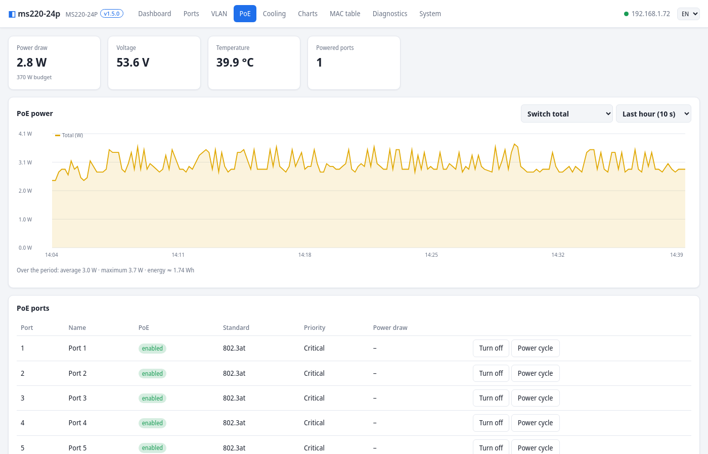
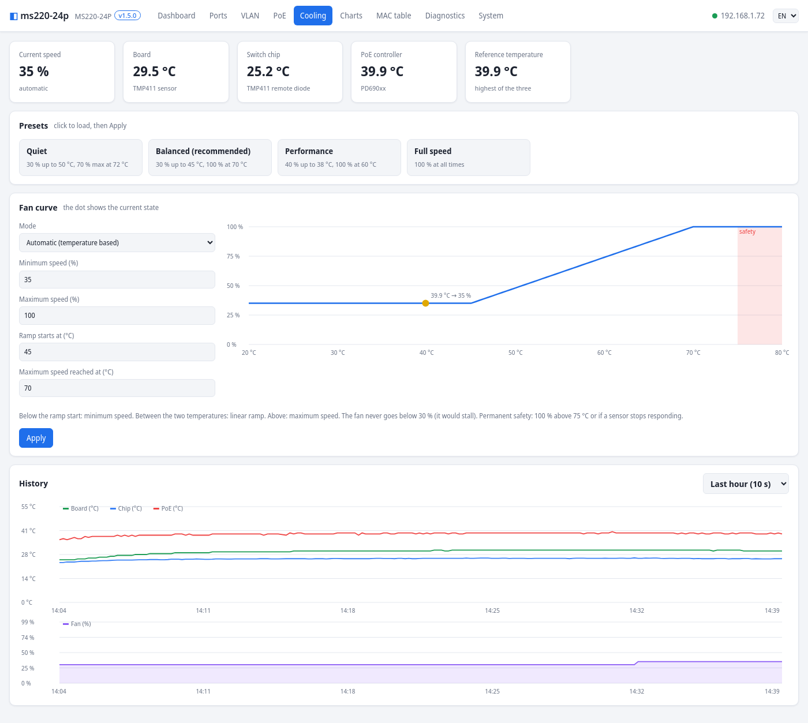
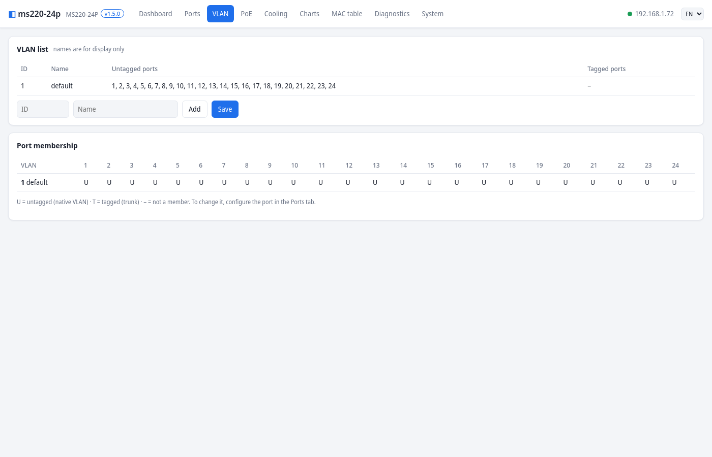
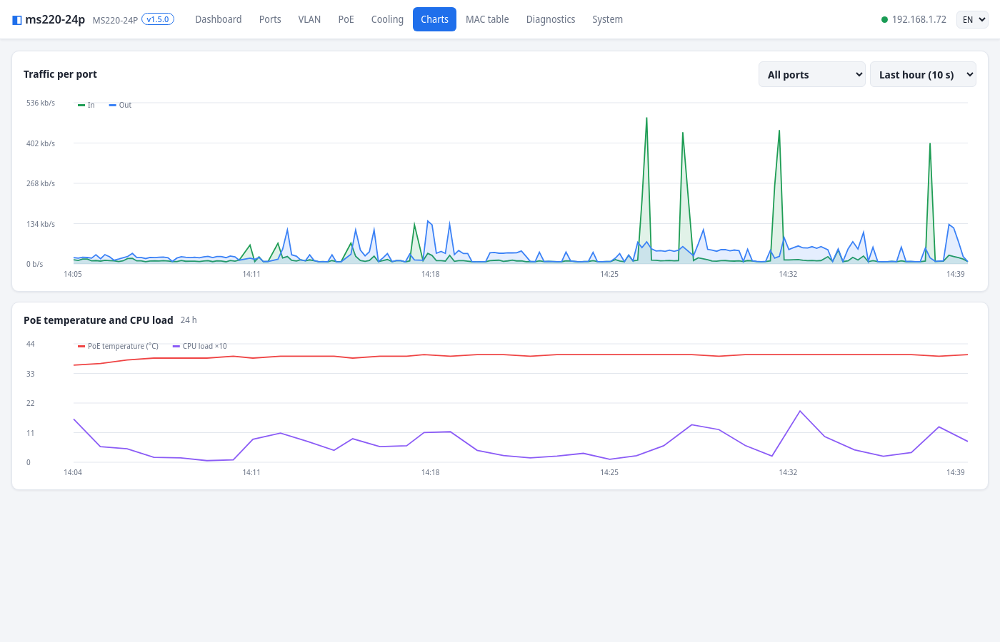
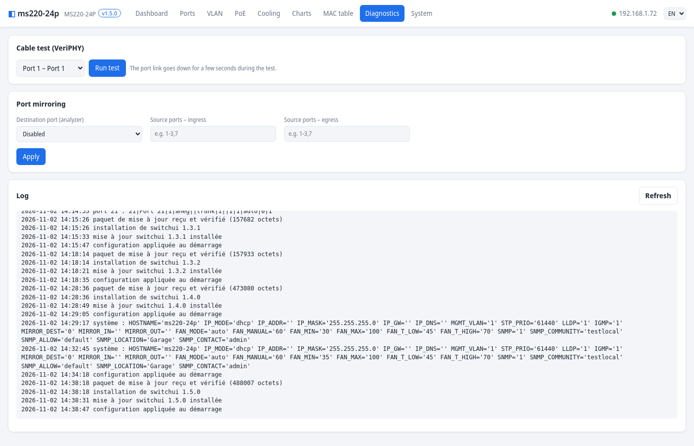
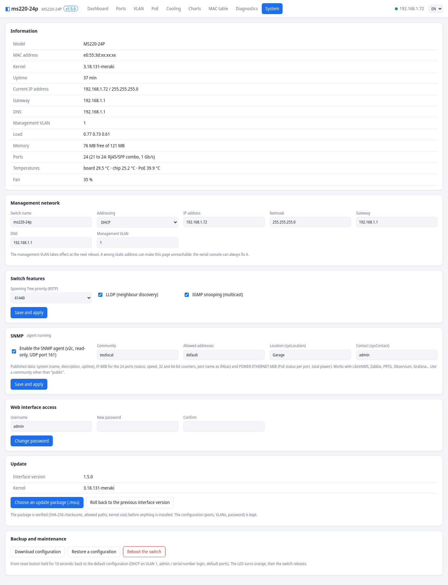

# Meraki MS220-24P — local firmware, no cloud

Free firmware and a local web management interface for the **Cisco Meraki MS220-24P**. It gives a second life to a switch that is stuck in a Meraki organisation you cannot access, or whose licence has expired, instead of throwing it away.

The switch boots a free Linux system (kernel 3.18.131 + buildroot). It drives the switching chip with **the Meraki modules already stored in its own NAND flash**, and is managed entirely locally from a web browser.

| Light mode | Dark mode |
|---|---|
|  |  |

This project builds on Hal Martin's work ([meraki-builder](https://github.com/halmartin/meraki-builder)). It adds:
- support for the **2023 Meraki firmware** (kernel 3.18.131);
- the exact location of the **MS220-24P serial console (J3)**;
- a complete web interface, SNMP and an update system based on packages.

> **Warning.** You need to desolder the flash chip, reprogram it and solder it back. A mistake can leave the switch unusable. **Always** back up the original chip before writing anything: that backup lets you go back exactly to where you started.

---

## Contents

1. [What works](#1-what-works)
2. [What you need](#2-what-you-need)
3. [Overview](#3-overview)
4. [Back up the original chip](#4-back-up-the-original-chip)
5. [Serial console (J3)](#5-serial-console-j3)
6. [Build the image](#6-build-the-image)
7. [Write the image and first boot](#7-write-the-image-and-first-boot)
8. [Web interface](#8-web-interface)
9. [Updates](#9-updates)
10. [SNMP](#10-snmp)
11. [Reset button](#11-reset-button)
12. [Cooling](#12-cooling)
13. [SSH access](#13-ssh-access)
14. [Going back to the Meraki firmware](#14-going-back-to-the-meraki-firmware)
15. [Troubleshooting](#15-troubleshooting)
16. [How it works](#16-how-it-works)
17. [Repository layout](#17-repository-layout)
18. [Credits and licences](#18-credits-and-licences)

---

## 1. What works

| Feature | Details |
|---|---|
| Switching on 24 ports | 10/100/1000 Mb/s, Meraki's Vitesse driver |
| Ports 21 to 24 | **combo** ports, RJ45 or SFP 1 Gb/s: only one at a time, copper wins. An inserted SFP module is detected and shown (vendor, part number) |
| PoE / PoE+ | 802.3af/at on all 24 ports, power off and power-cycle per port, power measurement |
| VLANs | access ports and trunks (allowed VLANs, native VLAN), management VLAN |
| Ports | enable/disable, forced speed and duplex, isolation, broadcast storm protection |
| Spanning Tree | RSTP, bridge priority, edge port automatic or forced |
| LLDP, IGMP snooping | can be turned on or off |
| Port mirroring | ingress and/or egress, to an analyzer port |
| Cable test | VeriPHY: status and length of the 4 pairs |
| Connected devices | for each port: IP address, name (mDNS) and MAC address of the devices, passively learned by the Meraki engine |
| Monitoring | traffic per port, PoE, temperatures, fan, 1 h and 24 h history |
| SNMP | read-only agent: IF-MIB (24 ports, 64-bit counters) and POWER-ETHERNET-MIB |
| Cooling | temperature-driven fan control, with presets |
| Administration | DHCP or static address, name, password, configuration backup and restore |
| Updates | `.msu` packages uploaded from the interface (interface and/or kernel) |
| Reset button | held 10 s: back to the default configuration |
| Clock | NTP sync (gateway, then pool.ntp.org) |
| Languages | English and French, chosen from the browser language or the selector in the header |

**The SFP ports are not 10 Gb/s.** On the MS220-24P, the 4 SFP cages are 1 Gb/s ports shared with RJ45 ports 21 to 24 (see the [Meraki documentation](https://documentation.meraki.com/Switching/MS_-_Switches/Operate_and_Maintain/How-Tos/MS_Switch_SFP_and_SFP__Overview)). The VSC7427 chip does not do 10 Gb/s.

**Tested model:** MS220-24P with the Meraki firmware of **18 March 2023**, kernel `3.18.131-meraki`, in the NAND. For other firmware, see [Adapting to another Meraki firmware](#adapting-to-another-meraki-firmware).

---

## 2. What you need

- **SPI flash programmer**: XGecu **TL866II+** (tested), with a **SOP16 adapter** (or SOP16 to DIP). It is driven on Linux by [minipro](https://gitlab.com/DavidGriffith/minipro).
- **Hot air station** and soldering iron, flux, desoldering braid. The chip is a SOP16 with a 1.27 mm pitch.
- **3.3 V USB-serial adapter**: CP2102, FTDI set to 3.3 V, etc. **Not 5 V.**
- **Two resistors**: 1 kΩ and 1.3 kΩ (or 1.2 kΩ). They bring the signal sent to the switch down to about 1.8 V.
- **Dupont wires**, or a small 4-pin 2.54 mm header soldered on J3.
- **A Linux PC** (Debian, Ubuntu…) with about 10 GB free to build the image.

---

## 3. Overview

```
1. Open the switch, desolder the NOR flash chip U6 (Macronix MX25L12845E, 16 MB)
2. Read the chip twice with the programmer, compare, keep the backup safe
3. Build the image (./build.sh) or use the prebuilt one in release/
4. Write the image to the chip, read it back, compare
5. Solder the chip back, connect the serial console to J3 (optional but recommended)
6. Power on: about 3 minutes later, the interface answers on http://DHCP_ADDRESS/
```

The **NAND (128 MB) is never modified**. It holds the Meraki firmware. At every boot, the switching chip driver modules and the Click configuration template are read from it.

---

## 4. Back up the original chip

### Find and desolder the chip

The NOR flash is chip **U6**, a **SOP16** marked **MXIC MX25L12845E** (ID `0xC22018`). It sits next to the fan, above connector **J18**. **Pin 1** is the top-left one, next to the printed "1". Note its orientation before desoldering, so you can put it back the same way.


### Install minipro

```sh
sudo apt install build-essential pkg-config libusb-1.0-0-dev git
git clone https://gitlab.com/DavidGriffith/minipro.git
cd minipro && make
sudo cp udev/60-minipro.rules /etc/udev/rules.d/ && sudo udevadm control --reload-rules
# unplug and replug the TL866
```

### Read the chip twice

Put the chip in the SOP16 adapter, pin 1 the right way round.

```sh
./minipro -p "MX25L12845E@SOP16" -D                          # must print Chip ID: 0xC22018  OK
./minipro -p "MX25L12845E@SOP16" -r backup-1.bin
./minipro -p "MX25L12845E@SOP16" -r backup-2.bin
sha256sum backup-1.bin backup-2.bin                           # both checksums must match
```

If the ID reads `0xFFFFFF`, or the two reads differ, the chip is not making good contact: reseat it and try again. **Copy the backup somewhere safe** (another disk, a USB stick). It is your only way back to the original Meraki firmware.

---

## 5. Serial console (J3)

The console is **optional** for an installation that goes well. It is **essential to diagnose** a problem: it shows the whole boot and gives a root shell.


Connector **J3** is next to the 12 V power connector, left of J4. **J2 and J4 are not the console.**

| J3 pin | Signal | Level | Connection |
|---|---|---|---|
| 1 | 3.3 V | power | **leave unconnected** |
| 2 | switch TX | 3.3 V idle | → adapter **RX**, directly |
| 3 | switch RX | **1.8 V** | ← adapter **TX**, **through the voltage divider** |
| 4 | GND | ground | → adapter **GND** |

The switch RX input (pin 3) works at **1.8 V**. A 3.3 V TX wired directly could damage it. You need a voltage divider:

```
  USB-serial adapter (3.3 V)                    Switch, connector J3
  ┌──────────┐                                  ┌──────────────────┐
  │      RX  ├──────────────────────────────────┤ 2  TX            │
  │          │                                  │                  │
  │      TX  ├────[ 1 kΩ ]────────┬─────────────┤ 3  RX (1.8 V)    │
  │          │                    │             │                  │
  │          │                [ 1.3 kΩ ]        │                  │
  │          │                    │             │                  │
  │     GND  ├────────────────────┴─────────────┤ 4  GND           │
  └──────────┘                                  │ 1  3.3 V: unused │
                                                └──────────────────┘
       3.3 V × 1.3 / (1 + 1.3) ≈ 1.87 V on pin 3
```

Settings: **115200 baud, 8 data bits, no parity, 1 stop bit (8N1), no flow control**.

```sh
sudo apt install picocom
picocom -b 115200 /dev/ttyUSB0          # quit: Ctrl+A then Ctrl+X
```

Tips:
- **Power on the switch first, then plug in the adapter's USB.** Otherwise, powering on can make the USB adapter disconnect, because of the ground difference.
- To only **read** the boot log, wires 2 (to RX) and 4 (GND) are enough.
- With the original Meraki firmware, the console shows the boot, then a `<Meraki>` prompt that rejects every command. This is expected.
- With this firmware, the console gives a **root shell** directly (`~ #`).

---

## 6. Build the image

### Option A: prebuilt image

`release/switch-local-1.5.0.bin.gz` is the image produced by `./build.sh` from this repository (interface 1.5.0, kernel 3.18.131-meraki). Check it before writing it:

```sh
gunzip -k release/switch-local-1.5.0.bin.gz
sha256sum release/switch-local-1.5.0.bin
# f41e8a7f5b70b8268e5817328b1b4937bcaa9c0800511bf5e7eef422d8c86821
```

> **Not yet tested on hardware.** This exact image was built from scratch with `./build.sh` and checked offline (RedBoot identical to the one running on the test switch, partition headers, kernel version and structure layouts, files in the system). It has **not** been written to a chip and booted yet. The test switch runs the same kernel and interface, installed step by step. Keep your backup at hand.

`release/kernel-3.18.131-meraki.part` is the kernel alone, for an update package (`tools/make-update.sh -k`).

### Option B: build it yourself

On Debian or Ubuntu:

```sh
sudo apt install build-essential git wget cpio unzip rsync bc file python3 xz-utils bzip2 \
                 libncurses-dev libssl-dev flex bison perl openssl
git clone https://github.com/JeremC82/Meraki-MS220-24P-Local.git
cd Meraki-MS220-24P-Local
./build.sh                    # 1 to 2 hours the first time
```

The script downloads and assembles:

| Part | Source |
|---|---|
| buildroot 2023.02.4 | buildroot.org, configuration `firmware/rootfs/buildroot.config` |
| MS220 scripts and packages | [meraki-builder](https://github.com/halmartin/meraki-builder) (pinned commit) + `firmware/rootfs/overlay` |
| Kernel | Meraki GPL sources 3.18.123 ([switch-11-22-ms220](https://github.com/halmartin/switch-11-22-ms220)) + Linux stable updates 3.18.124 to 3.18.131 (kernel.org) + `firmware/kernel/0001-skbuff-cb-96-octets.patch` + `firmware/kernel/config-3.18.131-meraki` |
| RedBoot | `redboot-nocrc-sz.bin` from [MS42-GPL-sources-3-18-122](https://github.com/halmartin/MS42-GPL-sources-3-18-122), checksum verified |
| `assoc_stub.ko` | `firmware/assoc_stub`, built against the kernel |
| Web server | busybox 1.36.1 reduced to `httpd` (`firmware/httpd`) |
| SNMP agent | net-snmp 5.9.3 from buildroot (agent only, with `pass_persist`) |
| Interface | `switchui/` |

Output:
- `build/switch-local.bin`: the full chip image (16 MB);
- `build/kernel/kernel.part`: the kernel only, for an update package.

Image layout:

| Address | Size | Partition | Content |
|---|---|---|---|
| `0x000000` | 256 KB | redboot | RedBoot without CRC or size check |
| `0x040000` | 2.75 MB | kernel | `SPIM` header (load and entry at `0x81000000`) + compressed kernel |
| `0x300000` | 8 MB | squashfs | read-only system |
| `0xB00000` | 5 MB | config | jffs2: persistent area overlaid on `/etc` and `/root` |

---

## 7. Write the image and first boot

```sh
./minipro -p "MX25L12845E@SOP16" -D                         # Chip ID: 0xC22018  OK
./minipro -p "MX25L12845E@SOP16" -w build/switch-local.bin   # erases, writes, verifies (about 3 min)
./minipro -p "MX25L12845E@SOP16" -r readback.bin
sha256sum build/switch-local.bin readback.bin               # checksums must match
```

Solder the chip back, **pin 1 on the same side as originally**, and check with a multimeter that no pins are bridged. Connect a switch port to your network (with a DHCP server), then power on.

**First boot, in order (serial console):**
1. RedBoot, then `Linux version 3.18.131-meraki`;
2. modules read from the NAND: `Modules trouvés dans part1`, then `Loaded 'luton26/vtss_core.ko …'` … `Loaded 'luton26/vc_click.ko'`. The message `Request for unknown module key 'Cisco Meraki…'` is expected;
3. `Using IP address: 192.168.x.y` (address obtained by DHCP on VLAN 1);
4. `switchui: http://192.168.x.y/`.

Allow **about 3 minutes** between power-on and the web interface answering. Without a console, look for the switch IP in the DHCP lease list of your router. Its MAC address starts with `e0:55:3d` or `88:15:44` (Meraki prefixes).

**Default web interface credentials:**
- username: `admin`;
- password: **the switch serial number**, in capitals, **without dashes**, as printed on the label (for example `Q2XXABCD1234`).

Change it in **System → Web interface access**.

---

## 8. Web interface

It is served on `http://SWITCH_ADDRESS/` (port 80), with authentication. Requests coming from another website are rejected.

| Tab | Content |
|---|---|
| **Dashboard** | front panel of the 24 ports, inbound and outbound traffic, PoE, temperature, fan, load. **Clicking a port** opens its settings, the list of connected devices (IP, name, MAC) and the history of its traffic and PoE |
| **Ports** | table of all ports: state, link, VLAN, PoE, STP, traffic, counters, MAC addresses |
| **VLAN** | named VLAN list and port membership table (U untagged / T tagged) |
| **PoE** | power draw, voltage, temperature, power off and power-cycle per port, chart per device |
| **Cooling** | fan speed, temperatures, fan curve, presets, history |
| **Charts** | traffic per port or total, over 1 h (10 s steps) or 24 h (1 min steps) |
| **MAC table** | learned addresses with the device IP and name, filter, flush |
| **Diagnostics** | cable test, port mirroring, log |
| **System** | IP address (DHCP or static), management VLAN, name, RSTP, LLDP, IGMP, SNMP, password, update, backup and restore, reboot |

| Ports | Port settings |
|---|---|
|  |  |
| **PoE** | **Cooling** |
|  |  |
| **VLAN** | **Charts** |
|  |  |
| **Diagnostics** | **System** |
|  |  |

Dark mode follows the operating system setting (see `docs/captures/dark/`).

**The configuration is saved** in the persistent area (`/etc/switchui/*.conf`) and applied again at every boot.
- **Changing the management VLAN** takes effect at the next reboot.
- **A wrong static IP address** or **a wrong VLAN on the access port** can cut access to the interface. The serial console or the [reset button](#11-reset-button) get you back in.

---

## 9. Updates

### Installing an update

**System → Update → Choose an update package (.msu)**, then **Install**. The interface shows the package content before installing it. The package is **verified** before anything changes:
- SHA-256 checksum of every file;
- allowed paths only (`/etc`, kernel);
- kernel size and header.

A corrupted or non-compliant package is rejected.

- **Interface only**: it is prepared next to the current one (`/etc/switchui.new`), then switched over in one step. A power cut therefore leaves either the old version complete, or the new one, never a mix. The configuration (ports, VLANs, system, password) is kept.
- **Kernel**: it is written to the `kernel` partition, read back and verified, then the switch reboots (about 3 minutes). **Do not cut the power during this step.** An incomplete kernel prevents booting, and the chip then has to be rewritten with the programmer.
- **Roll back**: a button in the same card restores the previous interface, keeping the configuration.

### Making an update package

After changing the interface (`switchui/`), or rebuilding the kernel:

```sh
# interface only
echo 1.6.0 > switchui/VERSION
tools/make-update.sh -v 1.6.0 -d "Description of the update"

# interface + SNMP agent (for switches installed before SNMP support)
tools/make-update.sh -v 1.6.0 -d "Interface and SNMP" -e extras

# interface + new kernel (automatic reboot)
tools/make-update.sh -v 1.6.0 -d "New kernel" -k build/kernel/kernel.part

# kernel only
tools/make-update.sh -v 1.6.0 -n kernel -d "Kernel only" -k build/kernel/kernel.part --no-ui
```

| Option | Purpose |
|---|---|
| `-v VERSION` | **required**, shown in the interface |
| `-n NAME` | package name (default `switchui`) |
| `-d TEXT` | description shown before installing (no `"`, `$`, `` ` ``, `\`) |
| `-k FILE` | kernel (`kernel.part`) to write to the chip |
| `-s FILE` | script run on the switch after the files are copied |
| `-e DIR` | extra files to install in `/etc` (tree relative to `/etc`) |
| `-r` | reboot after installing |
| `-o FILE` | output package name (default `NAME-VERSION.msu`) |
| `--no-ui` | do not include the interface |

`.msu` package format (gzip-compressed tar archive):

```
manifest      NAME="…"  VERSION="…"  DESCRIPTION="…"  REBOOT="0|1"
sha256sums    checksum of every file in the package
etc/…         files installed in /etc (etc/switchui/… = interface)
kernel.part   (optional) kernel partition image, SPIM header, 0x2C0000 bytes max
install.sh    (optional) script run after copying
```

During development, you can also copy files over SSH (see below), then restart the interface with `/etc/init.d/S95switchui restart`.

---

## 10. SNMP

Enable it in **System → SNMP**: community, allowed addresses (`default` for any, or a network such as `192.168.1.0/24`), location and contact. The agent is **read-only**, SNMP v2c, on UDP port 161. **Use a community other than `public`.**

| Data | OIDs |
|---|---|
| System | `sysName`, `sysDescr` (model, interface version, kernel), `sysUpTime`, `sysLocation`, `sysContact` |
| IF-MIB `ifTable` | 24 interfaces: `ifDescr` (`Port N`), `ifType`, `ifMtu`, `ifSpeed`, `ifAdminStatus`, `ifOperStatus`, 32-bit octet and packet counters |
| IF-MIB `ifXTable` | `ifName` (`portN`), **64-bit counters** (`ifHCInOctets`, `ifHCOutOctets`…), `ifHighSpeed`, `ifAlias` (port name set in the interface) |
| POWER-ETHERNET-MIB | per port: `pethPsePortAdminEnable`, `pethPsePortDetectionStatus` (3 = powering a device); total: `pethMainPsePower` (370 W), `pethMainPseConsumptionPower` |

```sh
snmpwalk -v2c -c MY_COMMUNITY SWITCH_ADDRESS .1.3.6.1.2.1.31.1.1.1      # ifXTable
```

It works with LibreNMS, Zabbix, PRTG, Observium, Grafana… The port counters come from the Meraki switching engine. They are refreshed every 10 seconds.

---

## 11. Reset button

**Hold the front reset button for 10 seconds** while the switch is running. The power LED turns orange, then the switch reboots with:
- the IP address in **DHCP** on VLAN 1;
- the web login **admin / serial number**;
- **default** ports, VLANs and system settings.

The firmware, the modules and the interface stay installed: this resets **this firmware's** configuration, it does not bring back the Meraki firmware. A short press does nothing.

The button is wired to **GPIO 4** of the Vitesse chip (0 = pressed). It is watched by `sbin/sui-button`, from about 3 minutes after power-on.

---

## 12. Cooling

The fan is PWM-driven (`/sys/class/hwmon/*/duty`, `vcoreiiipwmfan` driver) from **the highest** of these temperatures:
- board and switching chip (**TMP411** sensor);
- PoE controller (**PD690xx**).

| Preset | Behaviour |
|---|---|
| Quiet | 30 % up to 50 °C, then up to 70 % at 72 °C |
| **Balanced** (default) | 30 % up to 45 °C, then up to 100 % at 70 °C |
| Performance | 40 % up to 38 °C, then up to 100 % at 60 °C |
| Full speed | 100 % at all times |

The minimum speed is **30 %**: below that, the fan may stall. **Permanent safety**: 100 % above 75 °C, or if no sensor responds. A new setting takes effect immediately.

---

## 13. SSH access

- Command: `ssh root@SWITCH_ADDRESS`.
- Password: **the serial number** (set at first boot by meraki-builder's `S14passwd`).
- For key-based login, add your public key to `/root/.ssh/authorized_keys`.
- `/etc` and `/root` are persistent (jffs2). The rest of the system is read-only.

Useful commands:

```sh
cat /click/sw0_ctrl/port_status                  # link of each port
cat /click/switch_port_table/dump_pport_vlans    # VLANs per port
cat /click/client_ip_table/list                  # devices seen behind each port
pd690xx -l                                       # PoE per port
cat /tmp/sui/actions.log                         # actions done from the interface
/etc/init.d/S95switchui restart                  # restart the interface
```

---

## 14. Going back to the Meraki firmware

Desolder the chip and write the original backup:

```sh
./minipro -p "MX25L12845E@SOP16" -w backup-1.bin
./minipro -p "MX25L12845E@SOP16" -r readback.bin && sha256sum backup-1.bin readback.bin
```

Solder the chip back: the switch boots exactly as before, since the NAND was never modified.

---

## 15. Troubleshooting

| Symptom | Likely cause and fix |
|---|---|
| Nothing on the console | wrong pin: the switch TX is J3 **pin 2**, ground is pin 4. Check 115200 8N1 |
| Garbage on the console | poor ground connection, or adapter not at 3.3 V |
| The USB adapter disconnects at power-on | plug the USB in **after** powering on the switch |
| The switch does not boot at all | chip badly soldered, or image badly written: read the chip back and compare the checksum |
| `part1 contient des modules pour 3.18.x, le noyau est 3.18.131` | the Meraki firmware in your NAND is not the tested one: see below |
| Boot hangs while loading the modules | power-cycle: at the next boot, module loading is **skipped** automatically (`/etc/kmods_pending` flag) and the console gives a shell. Try again with `/etc/init.d/S08kmods start` |
| No IP address | without DHCP after 60 s, the switch uses `169.254.0.10`. Connect a port to a network with DHCP, or set a static address |
| Web page unreachable after an address or VLAN change | [reset button](#11-reset-button) for 10 s, or serial console |
| Ports up but no traffic | check on the console that the 6 modules are loaded (`lsmod`) and that `Router could not be initialized` does not appear |
| A disabled port keeps an orange LED | the orange LED shows **PoE power**: the device stays powered when only the data link is disabled. Turn PoE off as well |

### Adapting to another Meraki firmware

The Meraki modules only load into a kernel **built exactly like Meraki's**. If your NAND holds another firmware:
1. **Version**: the console shows `part1 contient des modules pour 3.18.X`. You need a `3.18.X-meraki` kernel: adapt the stable update loop in `firmware/kernel/build-kernel.sh`. The modules' `vermagic` string must match (`strings vtss_core.ko | grep vermagic`).
2. **`struct module`**: compare the size of the `.gnu.linkonce.this_module` section and the offsets of `init_module` and `cleanup_module` (`readelf -SW`, `readelf -r`) between a Meraki module and a module built with your kernel. Here, `CONFIG_MODULE_SIG=y` added the 4 missing bytes.
3. **`struct sk_buff`**: compare the offsets read by `vc_click.ko` (disassembly of `FromVitesse::alloc_pkt` and `xtr_cb`) with `offsetof()` in your kernel. Here, `cb[]` had to be 96 bytes.
4. **Missing symbols** (`Unknown symbol` when loading): provide them in `firmware/assoc_stub`, like `register_click_association_table_cbs`.

---

## 16. How it works

**Boot sequence**
1. RedBoot (`redboot-nocrc-sz`) loads the `SPIM` header at `0x40000`, then decompresses and starts the kernel at `0x81000000`.
2. The kernel mounts the squashfs (`root=/dev/mtdblock3`), then the jffs2 area as an overlay on `/etc` and `/root`.
3. `S08kmods` finds the gzip archive of the Meraki firmware in UBI volume `part1` (then `part2`) of the NAND, with `find_hdr`. It extracts `lib/modules/*` and `etc/switch.template`, checks the version, then loads `vtss_core` → `assoc_stub` → `proclikefs` → `merakiclick` → `elts_meraki` → `vc_click`.
4. `S09clickinit` loads into the Click engine (`/click/config`) the configuration template **taken from the same firmware** as the modules.
5. `S10clickconfig` (meraki-builder) sets up a "blank" switch and gets the address by DHCP. `S11poe` initialises the PoE controller.
6. `S95switchui`:
   - copies the interface to `/etc/switchui` at first boot;
   - sets up DNS and NTP sync;
   - applies the saved configuration again;
   - starts the history collector, the fan controller, the reset button watcher, the SNMP agent and the web server.

**Why a modified 3.18.131 kernel.** Meraki only published the 3.18.123 sources. The 2023 firmware modules require:

| Requirement | Solution |
|---|---|
| `vermagic = 3.18.131-meraki mod_unload MIPS32_R2 32BIT` | official stable updates 3.18.124 to 3.18.131 + `CONFIG_LOCALVERSION="-meraki"` |
| `struct module` of 0x15c bytes (`init` at 0xc4) | `CONFIG_MODULE_SIG=y` (not enforced: modules signed by Meraki load with a simple warning) |
| `sk_buff.cb` of 96 bytes (data at 0xe0) | patch `0001-skbuff-cb-96-octets.patch` |
| `register_click_association_table_cbs` and `unregister_…` (Meraki kernel, unpublished code) | `assoc_stub` module providing them |

The modules do not use `MODVERSIONS`, so only the version string and the structure layouts matter.

**Interface.** A `busybox httpd` server (Basic authentication, CGI) runs two shell scripts:
- `cgi-bin/api` reads and writes the Click "handlers", for example:
  - `switch_port_table/set_port_phy_cfgs` (`PORT n, MODE aneg|off|forced, FORCE_SPEED 100fdx…`);
  - `set_vlan_allports_conf` (`PORT n, ALLOWED_VLANS "…", PVID…`);
  - `stp/set_many_port_cfgs`, `set_port_isolation`, `set_port_storm_control`;
  - `sw0_ctrl/mirror_port` and `mirror_ports` (`INGRESS_PORTS 1-3, EGRESS_PORTS 5`), `veriphy_start`, `client_ip_table/list`, `sfp_mgr/eeproms`…;
- `cgi-bin/update` handles `.msu` packages.

The pages are plain HTML, CSS and JavaScript with no external dependency, and the charts are drawn on canvas. The interface source text is French; `www/i18n.js` translates it to English.

**SNMP.** net-snmp answers the system MIB itself. IF-MIB and POWER-ETHERNET-MIB are delegated (`pass_persist`) to `sbin/sui-snmp`, which serves a table generated every 10 seconds by `sbin/sui-snmp-table` from the Click counters.

---

## 17. Repository layout

```
build.sh                         full image build
switchui/                        web interface (installed in /etc/switchui)
  www/                           pages, translations (i18n.js), cgi-bin/api, cgi-bin/update
  lib/sui.sh                     configuration and applying it to the switch
  sbin/sui-collect               history (traffic, PoE, temperatures)
  sbin/sui-fan                   fan control
  sbin/sui-button                reset button
  sbin/sui-snmp, sui-snmp-table  SNMP data for the ports
  init/S95switchui               interface startup
  bin/httpd                      web server (busybox, see firmware/httpd)
extras/switchui-snmp/            SNMP agent for updating already installed switches
tools/make-update.sh             builds .msu packages
firmware/
  kernel/                        script, configuration and patch for kernel 3.18.131-meraki
  assoc_stub/                    compatibility module
  rootfs/                        buildroot configuration and modified boot scripts
  httpd/                         web server build
  image/make-image.sh            assembles the 16 MB image
docs/                            photos and screenshots
```

---

## 18. Credits and licences

- **Hal Martin**: [meraki-builder](https://github.com/halmartin/meraki-builder) (GPL v3), the modified RedBoot and the mirrors of the Meraki GPL sources ([switch-11-22-ms220](https://github.com/halmartin/switch-11-22-ms220), [MS42-GPL-sources-3-18-122](https://github.com/halmartin/MS42-GPL-sources-3-18-122)). This project would not exist without that work.
- Linux kernel, buildroot, busybox: GPL v2. net-snmp: BSD licences.
- The boot scripts derived from meraki-builder (`firmware/rootfs/overlay`) remain under **GPL v3**. The rest of this repository is released under the same licence.
- **No Meraki file is distributed here.** The proprietary modules and the configuration template are read, at every boot, from the Meraki firmware already present in the NAND of your own switch.
- Cisco and Meraki are trademarks of Cisco Systems, Inc. This project is neither affiliated with nor endorsed by Cisco.
